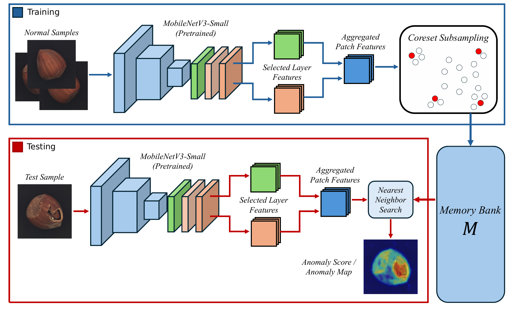
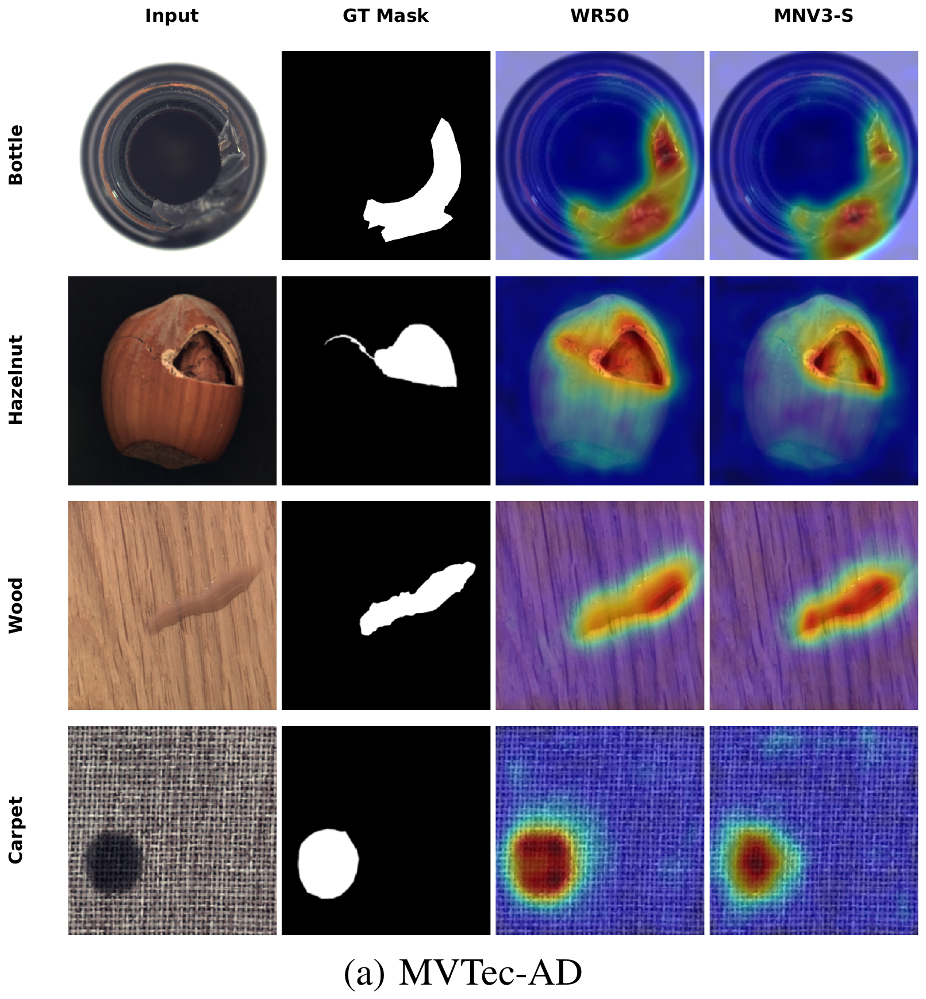
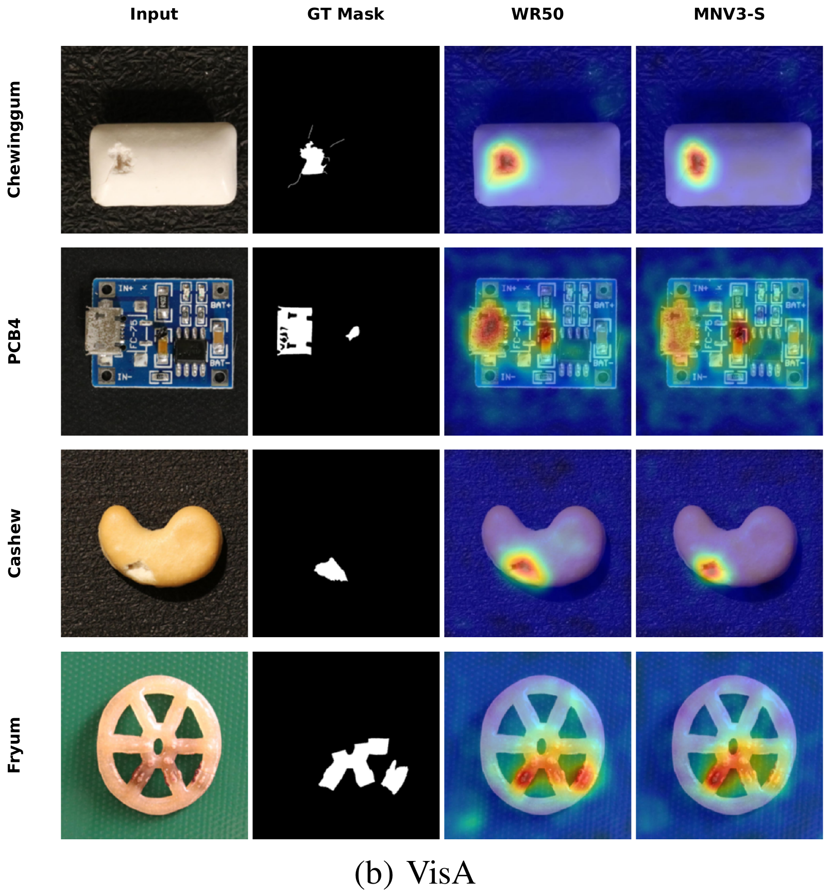

<div align="center">

# Lightweight PatchCore

### Toward Efficient Memory Bank-Based Anomaly Detection via Lightweight Backbone Adaptation

**Official research implementation**

**Junhyeok Im · Jeonghun Cho**

*IEEE 15th Global Conference on Consumer Electronics (GCCE), 2026*


**Presented at IEEE GCCE 2026. Publication in IEEE Xplore is pending.**

</div>

---

## Overview

This repository contains the implementation of **Lightweight PatchCore**, which replaces the original WideResNet50 backbone with MobileNetV3-Small for efficient industrial anomaly detection.

The approach retains PatchCore's memory bank and nearest-neighbor anomaly detection framework while substantially reducing computational cost and maintaining competitive anomaly detection and localization performance.

Pixel-level AUROC decreases by only **0.93 percentage points on MVTec AD** and **0.79 percentage points on VisA**, demonstrating a modest performance trade-off despite substantial efficiency gains.

## Method



- **Backbone:** MobileNetV3-Small (frozen, ImageNet-pretrained)
- **Feature layers:** `features.3` and `features.8`
- **Embedding dimension:** 128
- **Coreset sampling:** 10%
- **Nearest-neighbor search:** k = 1

## Results

Mean ± standard deviation over three random seeds.

| Dataset | Backbone | Image AUROC (%) | Pixel AUROC (%) |
|---|---|---:|---:|
| MVTec AD | WideResNet50 | **98.99 ± 0.08** | **98.12 ± 0.01** |
| MVTec AD | MobileNetV3-Small | 95.13 ± 0.25 | 97.19 ± 0.02 |
| VisA | WideResNet50 | **94.65 ± 0.07** | **98.52 ± 0.02** |
| VisA | MobileNetV3-Small | 92.12 ± 0.16 | 97.73 ± 0.03 |

## Qualitative Results

Visual comparison of anomaly localization results using WideResNet50 and MobileNetV3-Small.

<table>
  <tr>
    <th align="center">MVTec AD</th>
    <th align="center">VisA</th>
  </tr>
  <tr>
    <td width="50%">
      
    </td>
    <td width="50%">
      
    </td>
  </tr>
</table>

## Computational Efficiency

Compared with the WideResNet50 baseline:

- **27.1× fewer** backbone parameters
- **176.2× fewer** backbone FLOPs
- **5.32× faster** prediction on MVTec AD
- **5.97× faster** prediction on VisA

Prediction speed was evaluated on an NVIDIA A40 GPU using the complete PatchCore prediction pipeline.

## Getting Started

### Installation

```bash
git clone https://github.com/augustinus2000/lightweight-patchcore.git
cd lightweight-patchcore
pip install -e .
```


### Datasets

- [MVTec AD](https://www.mvtec.com/company/research/datasets/mvtec-ad)
- [VisA](https://github.com/amazon-science/spot-diff)

**VisA Preprocessing**

For our experiments, the VisA dataset was reorganized into a one-class directory structure similar to MVTec AD:

```text
visa_pytorch/1cls/
└── <category>/
    ├── train/
    │   └── good/
    ├── test/
    │   ├── good/
    │   └── bad/
    └── ground_truth/
        └── bad/
```

Images and corresponding ground-truth masks are processed using the following spatial transformations:

1. Resize the shorter side to 256 pixels while preserving the aspect ratio.
2. Apply a center crop to obtain a square 224 × 224 image.

Input images are subsequently normalized using ImageNet mean and standard deviation.

The VisA dataset loader expects the reorganized one-class directory structure. Dataset paths can be configured using the `MVTEC_ROOT` and `VISA_ROOT` environment variables.


### Run Experiments

```bash
# MobileNetV3-Small on MVTec AD
bash scripts/run_experiment.sh mvtec mnv3 0 0

# MobileNetV3-Small on VisA
bash scripts/run_experiment.sh visa mnv3 0 0
```

Use `wr50` instead of `mnv3` for the original backbone baseline. Repeat with seeds `0`, `1`, and `2` for three-seed evaluation.

## Citation

The paper was presented at IEEE GCCE 2026. The IEEE Xplore DOI will be added when available.

```bibtex
@inproceedings{im2026lightweightpatchcore,
  title     = {Toward Efficient Memory Bank-Based Anomaly Detection via Lightweight Backbone Adaptation},
  author    = {Im, Junhyeok and Cho, Jeonghun},
  booktitle = {2026 IEEE 15th Global Conference on Consumer Electronics (GCCE)},
  year      = {2026}
}
```

## Acknowledgments

This work is based on the original [PatchCore](https://github.com/amazon-science/patchcore-inspection) implementation (CVPR 2022).

Please refer to [LICENSE](LICENSE) and [NOTICE](NOTICE) for licensing and attribution. Dataset visualizations may have separate usage restrictions.
