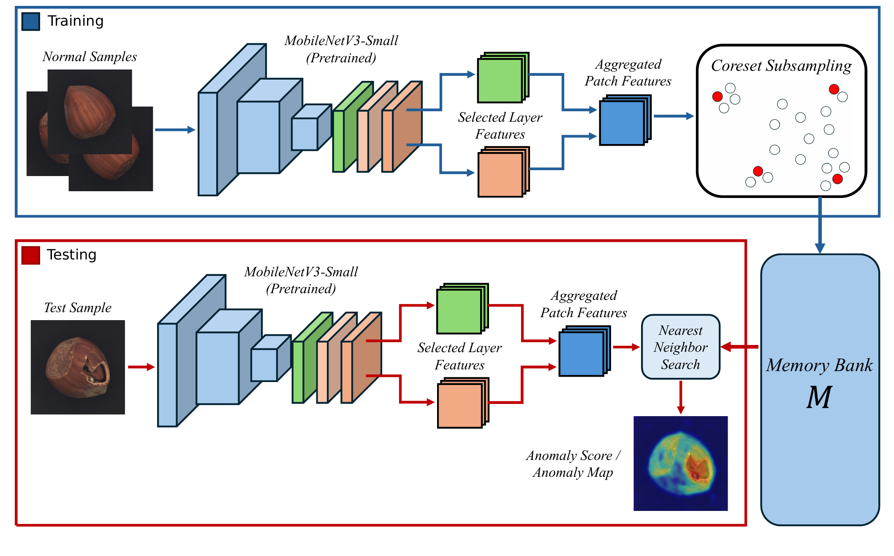
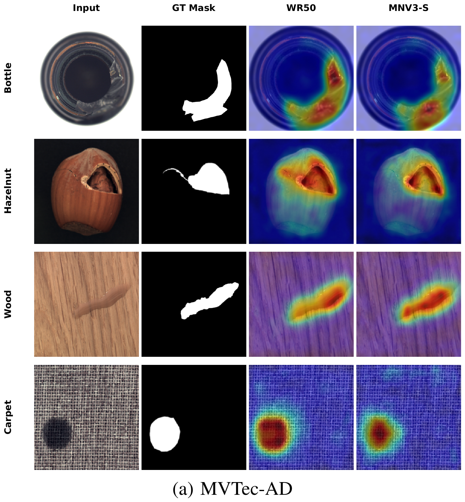
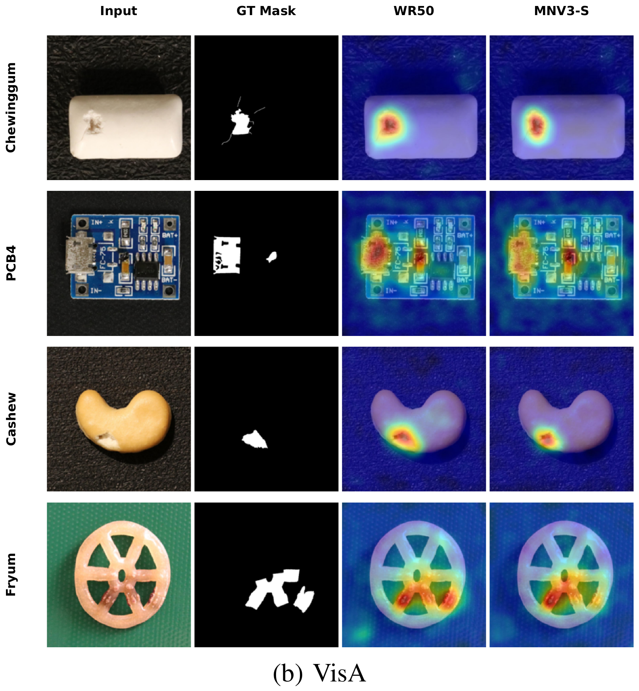

# Lightweight PatchCore: Efficient Memory Bank-Based Anomaly Detection

**Code and experimental results for the paper**  
**“Toward Efficient Memory Bank-Based Anomaly Detection via Lightweight Backbone Adaptation”**  
Junhyeok Im and Jeonghun Cho · **IEEE GCCE 2026**

This repository contains the research implementation and experimental configuration used to investigate **lightweight backbone adaptation for PatchCore**. We replace the original WideResNet50 (WR50) feature extractor with **MobileNetV3-Small (MNV3-S)** and evaluate the resulting accuracy–efficiency trade-off on **MVTec AD** and **VisA**.

> **Scope.** This work is an empirical study of backbone adaptation and its computational implications. It retains PatchCore's memory-bank construction and nearest-neighbor anomaly detection framework; it does **not** introduce a new anomaly scoring algorithm. This repository is **not** the official PatchCore implementation.

## Abstract

> This paper presents a lightweight backbone approach for memory bank-based image anomaly detection by replacing PatchCore’s original WideResNet50 backbone with MobileNetV3-Small. Experimental results show that, compared to the original PatchCore baseline, the proposed method reduces backbone parameters by approximately 27× and FLOPs by over 170× while maintaining competitive pixel-level performance with less than a one-percentage-point decrease in pixel-level AUROC. Averaged over three seeds, the proposed method achieves pixel-level AUROC scores of 97.19 on MVTec-AD and 97.73 on VisA. Under the evaluated timing setup, it provides 5.32× and 5.97× faster inference on the two datasets, respectively. These results demonstrate the potential of lightweight backbones for efficient edge deployment.

*Abstract from the GCCE 2026 paper.*

## Highlights

- **27.1× fewer backbone parameters** (68.88M → 2.54M).
- **176.2× fewer backbone FLOPs** (22.91G → 0.13G, rounded as reported in the paper).
- **5.32× / 5.97× faster prediction** on MVTec AD / VisA, respectively, in the evaluated NVIDIA A40 setup.
- **Less than 1 percentage point loss in pixel AUROC**: 0.93 pp on MVTec AD and 0.79 pp on VisA.
- Analysis of **feature-layer selection**, **embedding dimension**, and **coreset subsampling cost**.

## Method



The pipeline uses an ImageNet-pretrained, frozen MobileNetV3-Small backbone to extract multi-level patch features. Features from two intermediate layers are spatially aligned, aggregated into 128-dimensional embeddings, and used to construct a representative normal-feature memory bank via approximate greedy coreset subsampling. At inference, test patches are scored by their nearest-neighbor distances to memory-bank features.

| Setting | Original PatchCore baseline | Lightweight configuration |
|---|---|---|
| Backbone | WideResNet50 | MobileNetV3-Small |
| Feature layers | `layer2`, `layer3` | `features.3`, `features.8` |
| Final embedding dimension | 1024 | 128 |
| Patch size | 3 × 3 | 3 × 3 |
| Coreset sampling ratio | 10% | 10% |
| Nearest neighbors | 1 | 1 |
| Input preprocessing | Resize short side to 256; center crop 224 × 224 | Same |

The implementation uses a 128-dimensional random linear mapping for **coreset selection**; the selected original embeddings are stored in the memory bank. The feature extractor is not fine-tuned on the anomaly-detection datasets.

## Quantitative Results

Mean ± standard deviation across **three seeds (0, 1, 2)**. All AUROC values are percentages; higher is better.

| Dataset | Backbone | Image AUROC ↑ | Pixel AUROC ↑ |
|---|---|---:|---:|
| MVTec AD | WR50 | **98.99 ± 0.08** | **98.12 ± 0.01** |
| MVTec AD | MNV3-S | 95.13 ± 0.25 | 97.19 ± 0.02 |
| VisA | WR50 | **94.65 ± 0.07** | **98.52 ± 0.02** |
| VisA | MNV3-S | 92.12 ± 0.16 | 97.73 ± 0.03 |

The lightweight backbone preserves much of the pixel-level localization performance, while image-level detection exhibits a more noticeable reduction.

## Qualitative Results

Each row compares the **input image**, **ground-truth defect mask**, **WR50 anomaly map**, and **MNV3-S anomaly map**.

### MVTec AD



### VisA



## Computational Efficiency

### Backbone complexity

| Backbone | Parameters (M) ↓ | FLOPs (G) ↓ |
|---|---:|---:|
| WR50 | 68.88 | 22.91 |
| MNV3-S | **2.54** | **0.13** |
| Reduction | **27.1×** | **176.2×** |

FLOPs are reported using the paper's rounded figures, with 224 × 224 inputs.

### Prediction time

| Dataset | WR50 (ms/image) ↓ | MNV3-S (ms/image) ↓ | Speedup ↑ |
|---|---:|---:|---:|
| MVTec AD | 710.50 | **133.60** | **5.32×** |
| VisA | 2061.51 | **345.16** | **5.97×** |

Prediction time covers the **complete PatchCore prediction pipeline**, not just the CNN forward pass. Measurements were obtained on a single **NVIDIA A40 GPU**, with CUDA synchronization before and after prediction, and averaged per image across categories. Timing experiments use **seed 0**. These measurements are specific to the evaluated setup; edge-device latency has not been measured.

## Ablation Studies

Ablations are **single-run, class-averaged MVTec AD results (seed 0)** and should not be confused with the three-seed main results.

### Embedding dimension

Feature layers fixed at `features.3` and `features.8`.

| Dimension | Image AUROC ↑ | Pixel AUROC ↑ |
|---|---:|---:|
| 32 | 93.10 | 97.19 |
| 64 | 94.70 | **97.42** |
| **128 (default)** | **94.90** | 97.18 |
| 256 | 94.32 | 96.85 |
| 512 | 93.64 | 96.55 |
| 1024 | 93.56 | 96.45 |

We select **128 dimensions** as a balance of image-level detection, pixel-level localization, and compact representations. The 64-dimensional configuration achieves the highest pixel AUROC in this sweep.

### Feature-layer selection

Embedding dimension fixed at 128.

| Layers | Image AUROC ↑ | Pixel AUROC ↑ |
|---|---:|---:|
| (2, 6) | 92.45 | 96.86 |
| (2, 7) | 91.54 | 97.01 |
| (2, 8) | 92.64 | 97.15 |
| (2, 9) | 88.09 | 96.31 |
| (3, 7) | 94.87 | 97.03 |
| **(3, 8) (default)** | **94.90** | **97.18** |
| (3, 9) | 92.70 | 96.53 |
| (3, 10) | 93.28 | 96.81 |
| (4, 9) | 91.49 | 95.63 |
| (4, 10) | 91.99 | 95.59 |
| (5, 10) | 92.89 | 96.01 |
| (5, 11) | 92.94 | 94.82 |

### Coreset sampling rate

| Sampling ratio | Image AUROC ↑ | Pixel AUROC ↑ | Subsampling time (s) ↓ |
|---|---:|---:|---:|
| 5% | **95.16** | 97.05 | **7.44** |
| **10% (default)** | 94.90 | 97.18 | 14.85 |
| 20% | 94.83 | **97.21** | 29.65 |

Performance changes relatively little across these rates, whereas subsampling time increases substantially with the retained fraction. We use **10%** to maintain consistency with the PatchCore baseline.

### Fitting-time breakdown

**Definition of fitting time.** Here, *fitting time* is the elapsed time required to **construct the normal-feature memory bank from the training data**, measured over the complete `PatchCore.fit()` operation—not the time spent training or fine-tuning the CNN backbone. The backbone is frozen. Fitting consists of extracting and aggregating patch embeddings over the normal training loader, concatenating the collected embeddings, selecting representative embeddings by approximate greedy coreset subsampling, and fitting/building the FAISS nearest-neighbor index on the selected embeddings. Consequently, the reported total includes data-loading and other Python/runtime overhead encountered within `fit()`.

**Measurement boundaries.** The code measures total fitting time around `PatchCore.fit()` and measures the coreset stage around `self.featuresampler.run(features)`, with CUDA synchronization around the feature-collection timing and the outer fit call. The *rest of fitting* is the difference between those two measurements; it includes feature extraction, patch embedding construction, concatenation, FAISS index fitting, and associated overhead. Values in the table are category-averaged seconds for the seed-0 timing analysis, **not the time for all 15/12 categories combined**.

| Dataset | Backbone | Total fitting (s) | Coreset subsampling (s) | Share |
|---|---|---:|---:|---:|
| MVTec AD | MNV3-S | 18.60 | 14.84 | 79.8% |
| MVTec AD | WR50 | 22.28 | 16.05 | 72.0% |
| VisA | MNV3-S | 136.90 | 126.36 | 92.3% |
| VisA | WR50 | 144.26 | 126.52 | 87.7% |

**Remaining bottleneck:** Reducing backbone complexity does not proportionally reduce the cost of coreset construction. This motivates future work on more efficient memory-bank construction.

## Getting Started

### 1. Environment

The experiments were conducted with **PyTorch 2.4.1** and an **NVIDIA A40 GPU**. Use a compatible Python/CUDA/PyTorch environment and install the dependencies provided by this repository. If the package's setup file is present, install the local package with:

```bash
python -m pip install -e .
```

> **Before publishing:** Verify and document the complete dependency versions (including FAISS), installation procedure, and a clean-environment smoke test. The command above has not been independently executed against this release copy.

### 2. Datasets

Download the datasets from their original providers:

- **MVTec AD:** [MVTec AD dataset](https://www.mvtec.com/company/research/datasets/mvtec-ad)
- **VisA:** [VisA dataset / preprocessing reference](https://github.com/amazon-science/spot-diff)

Expected default directories:

```text
data/
├── mvtec/
│   ├── bottle/
│   ├── cable/
│   └── ...
└── visa_pytorch/
    └── 1cls/
        ├── candle/
        │   ├── train/good/
        │   ├── test/good/
        │   ├── test/bad/
        │   └── ground_truth/bad/
        └── ...
```

**Important:** VisA must be organized in the **one-class MVTec-style layout** expected by `src/patchcore/datasets/visa.py`. The upstream VisA download may require preprocessing or conversion. Raw datasets are **not included** in this repository.

To use alternative dataset locations, set `MVTEC_ROOT` and/or `VISA_ROOT` to the respective root directories.

### 3. Run experiments

The provided script specifies the principal backbone configurations recorded in the experiment logs. Its CLI syntax has been statically inspected, but a complete end-to-end reproduction has **not** been independently verified in a clean environment:

```bash
# MVTec AD, MobileNetV3-Small, seed 0, GPU 0
bash scripts/run_experiment.sh mvtec mnv3 0 0

# MVTec AD, WideResNet50 baseline
bash scripts/run_experiment.sh mvtec wr50 0 0

# VisA, MobileNetV3-Small
bash scripts/run_experiment.sh visa mnv3 0 0

# VisA, WideResNet50 baseline
bash scripts/run_experiment.sh visa wr50 0 0
```

For three-seed evaluation, repeat each main configuration with seeds `0`, `1`, and `2`. The script requests model and segmentation-image saving under `results/`; verify available disk space and the actual output directory behavior before running.

```bash
# Example: use a custom VisA data root
VISA_ROOT=/path/to/visa_pytorch/1cls bash scripts/run_experiment.sh visa mnv3 0 0
```

## Limitations

- Image-level AUROC decreases relative to WR50, despite competitive pixel-level localization.
- The coreset subsampling stage remains a major fitting-time bottleneck.
- Prediction speed was measured on an NVIDIA A40; **on-device edge performance, power, and energy consumption were not evaluated**.
- Ablation results use a single seed; main results use three seeds.

## Citation

If you use this research implementation or its experimental findings, please cite:

```bibtex
@inproceedings{im2026lightweightpatchcore,
  title     = {Toward Efficient Memory Bank-Based Anomaly Detection via Lightweight Backbone Adaptation},
  author    = {Im, Junhyeok and Cho, Jeonghun},
  booktitle = {2026 IEEE 15th Global Conference on Consumer Electronics (GCCE)},
  year      = {2026}
}
```

For the original PatchCore method, please also cite:

```bibtex
@inproceedings{roth2022totalrecall,
  title     = {Towards Total Recall in Industrial Anomaly Detection},
  author    = {Roth, Karsten and Pemula, Latha and Zepeda, Joaquin and Schölkopf, Bernhard and Brox, Thomas and Gehler, Peter},
  booktitle = {Proceedings of the IEEE/CVF Conference on Computer Vision and Pattern Recognition},
  year      = {2022},
  pages     = {14298--14308}
}
```

## Acknowledgments and Attribution

This project builds upon the [official PatchCore implementation by Amazon Science](https://github.com/amazon-science/patchcore-inspection), accompanying **“Towards Total Recall in Industrial Anomaly Detection”** (CVPR 2022). We acknowledge the original authors and retain their method attribution. MobileNetV3-Small is based on **“Searching for MobileNetV3”** (ICCV 2019).

The research was supported by the KIAT and IITP grants acknowledged in the GCCE 2026 paper.

**License and third-party assets:** Preserve the original PatchCore repository's license and copyright notices when publishing derived source files. Dataset images shown in qualitative examples originate from MVTec AD and VisA; review the applicable dataset usage and redistribution terms before making those images public.

### Dataset Image Attribution and Licensing

The qualitative visualizations in this repository include images from the following datasets:

- **MVTec AD:** Images originally provided by MVTec Software GmbH.
  Licensed under [CC BY-NC-SA 4.0](https://creativecommons.org/licenses/by-nc-sa/4.0/).
  The images were adapted to display ground-truth masks and anomaly localization results.
  The MVTec-derived visualization (`assets/qualitative_mvtec.png`)
  is shared under CC BY-NC-SA 4.0 for non-commercial use.
  Original dataset: https://www.mvtec.com/research-teaching/datasets/mvtec-ad

- **VisA:** Images from the Visual Anomaly (VisA) dataset
  by Zou et al., "SPot-the-Difference Self-Supervised Pre-training
  for Anomaly Detection and Segmentation" (ECCV 2022).
  Licensed under [CC BY 4.0](https://creativecommons.org/licenses/by/4.0/).
  The images were adapted to display ground-truth masks and anomaly localization results.
  Original dataset: https://registry.opendata.aws/visa/

These dataset image licenses apply to the respective visualizations
and do not replace the Apache 2.0 license governing the source code.
